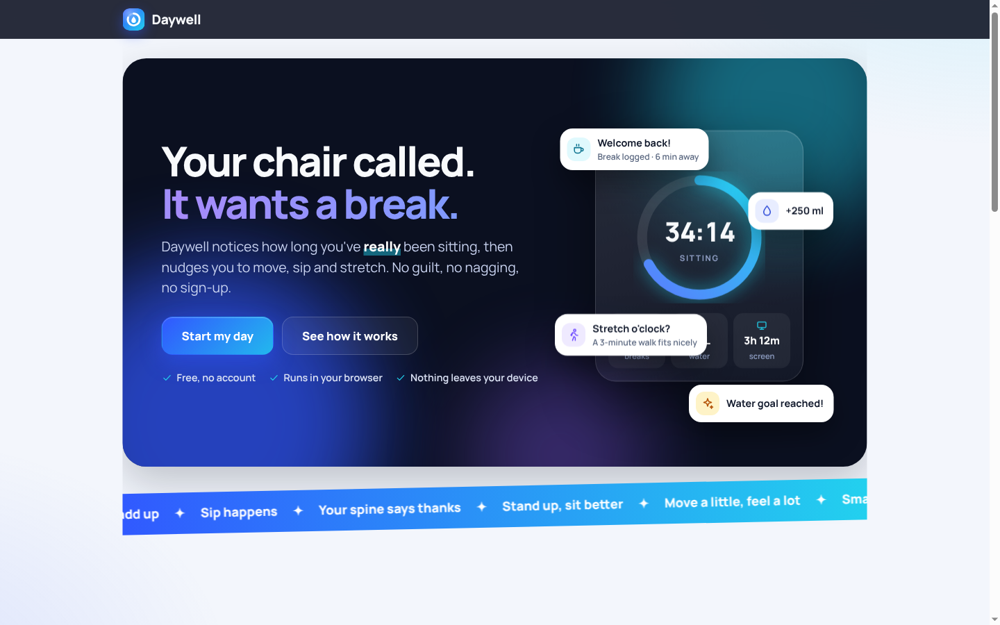
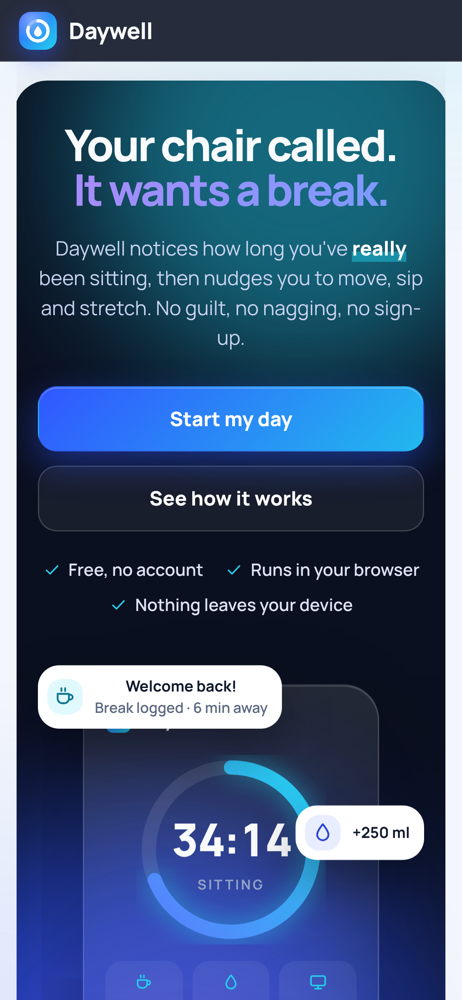
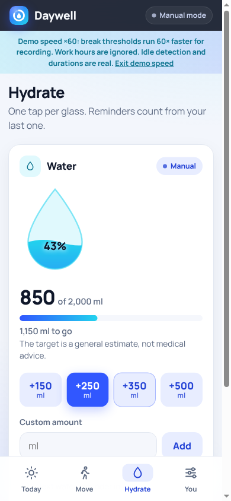
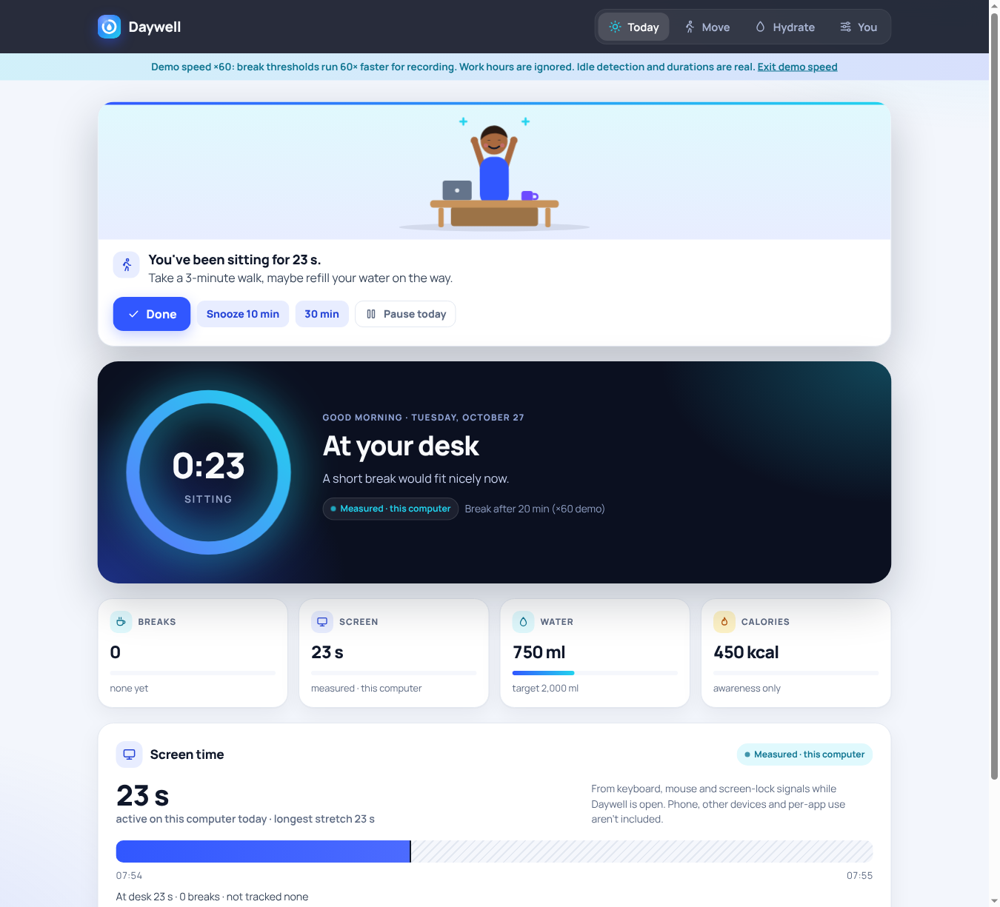

<p align="center"></p>

<h1 align="center">Daywell</h1>

<p align="center"><strong>Breaks based on real desk time, not a timer.</strong><br>
A calm browser companion for remote workers: it notices how long you've actually been sitting, nudges you to move and drink water, and keeps every number honest.</p>

<p align="center">
  <a href="https://github.com/PinnacleCryptNG/daywell/actions/workflows/ci.yml"></a>
  <a href="LICENSE"></a>
  
</p>

<p align="center"><strong><a href="https://daywell-tau.vercel.app/">Try it live → daywell-tau.vercel.app</a></strong> · demo speed: <a href="https://daywell-tau.vercel.app/?speed=60">?speed=60</a></p>

<p align="center"></p>

## What it does

- **Measured desk time.** In Chrome or Edge, Daywell uses the browser's [Idle Detection API](https://developer.mozilla.org/en-US/docs/Web/API/Idle_Detection_API) (keyboard, mouse and screen lock, with your permission) to know when you're really at the desk.
- **Breaks log themselves.** Step away for 2+ minutes and come back: the break is already logged with its real length. "Undo, I was here" fixes the rare false positive.
- **One gentle nudge at a time.** After about 50 minutes of continuous sitting, during work hours, capped per day. Done, snooze or pause for today.
- **Screen time on this computer**, measured from the same signal. Phones, other devices and per-app usage are not included, and the app says so.
- **Water**: one-tap logging plus reminders that count from your last glass and never pile up.
- **Calories (optional)**: off by default, manual entries only, no targets.
- **Honest numbers.** Every value is labelled *Measured*, *Manual* or *Reported*. Missing data shows as "No data", never as zero.

On phones, Safari and Firefox (no idle detection), Daywell detects the browser and device and switches to a clearly explained manual mode.

<p align="center">
  
  
</p>

<p align="center"></p>

## Run it locally

Requires Node.js 18+. There are no npm dependencies to install.

```sh
git clone https://github.com/PinnacleCryptNG/daywell.git
cd daywell
npm start        # http://localhost:5173
npm test         # 32 unit tests
```

Open `http://localhost:5173`, press **Start my day**, and allow idle detection when asked. Measured mode needs `localhost` or HTTPS; opening `index.html` straight from disk won't enable it.

**Demo speed:** `http://localhost:5173/?speed=60` runs break and reminder thresholds 60× faster (50 minutes takes 50 seconds) for recording. A banner shows while it's on. Idle detection and measured durations stay real.

## Deploy

Daywell is a static site with no build step.

- **Vercel:** import the repository, keep the default settings (no framework, no build command, output directory `.`). [`vercel.json`](vercel.json) adds the security headers.
- **Any static host** (GitHub Pages, Netlify, Cloudflare Pages) works too; serve the repository root over HTTPS.

No environment variables or secrets are needed.

## How it's built

Plain HTML, CSS and JavaScript modules. No framework, no build, no runtime dependencies.

```
index.html, styles.css     page shell, icon sprite, themes, responsive layout
src/sources/idle.js        Idle Detection adapter: "away" after 60 s without input or on screen lock
src/sources/manual.js      manual fallback ("I'm stepping away" / "I'm at my desk")
src/engine.js              pure desk-time logic: sitting stretches, breaks, prompts, snooze, work hours, cap
src/water.js, habits.js    water log and reminder rule; calories
src/reflection.js          end-of-day summary
src/device.js              browser/device detection and capability advice
src/store.js               localStorage persistence, validated on load
src/ui/                    view rendering and the "Your rhythm" preferences
sw.js                      service worker: offline cache and notifications
tests/                     node --test suites
```

[`devpost/app-map.html`](devpost/app-map.html) traces one action (walk away → break logged) through the code.

## Privacy and security

- No accounts, no server, no analytics, no third-party scripts or fonts. Everything stays in this browser's storage; export or delete it from the **You** tab.
- A strict Content-Security-Policy allows scripts only from this site and blocks inline scripts.
- Saved data is validated when it loads; malformed or tampered entries are dropped, and anything you type is escaped before it's shown.
- Works offline after the first visit and can be installed to the home screen.
- Accessibility: no issues in an axe WCAG 2.1 AA scan; Lighthouse 98–100 for performance, accessibility, best practices and SEO. Animations respect reduced-motion settings.

## Limitations

- Measured mode needs desktop Chrome or Edge 94+; elsewhere it's manual.
- Reminders need the tab open. Background tabs may deliver them up to about a minute late.
- Screen time covers only this computer while Daywell is open; time when it's closed shows as *not tracked*.
- A browser can't count steps or read phone screen time, so neither is included. A native phone app is on the roadmap.

## Built with the Devpost Learn skill pack

Made for [Build With AI: Basics](https://learn-ai-basics.devpost.com/). The planning documents are in [`devpost/`](devpost/): [scope](devpost/scope.md), [PRD](devpost/prd.md), [spec](devpost/spec.md) and the [build checklist](devpost/checklist.md).

## Not medical advice

Daywell offers general wellbeing nudges and is not a medical device. The water target is a general estimate.

## License

[MIT](LICENSE). The Manrope font is licensed under the SIL Open Font License ([`assets/fonts/OFL.txt`](assets/fonts/OFL.txt)).
